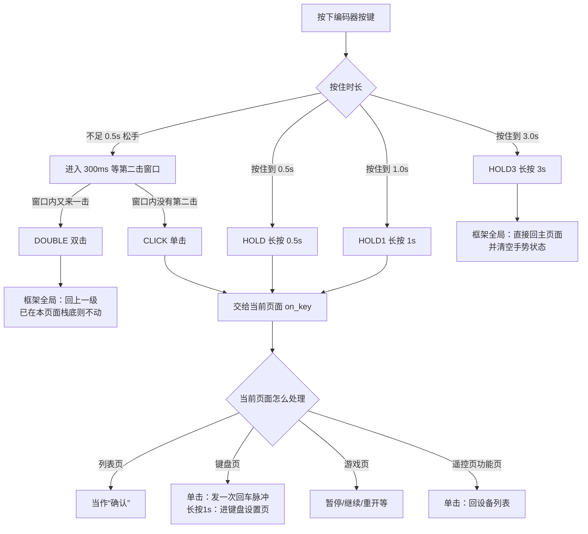
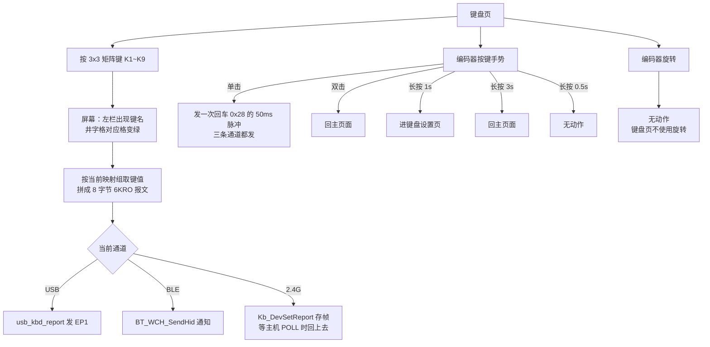
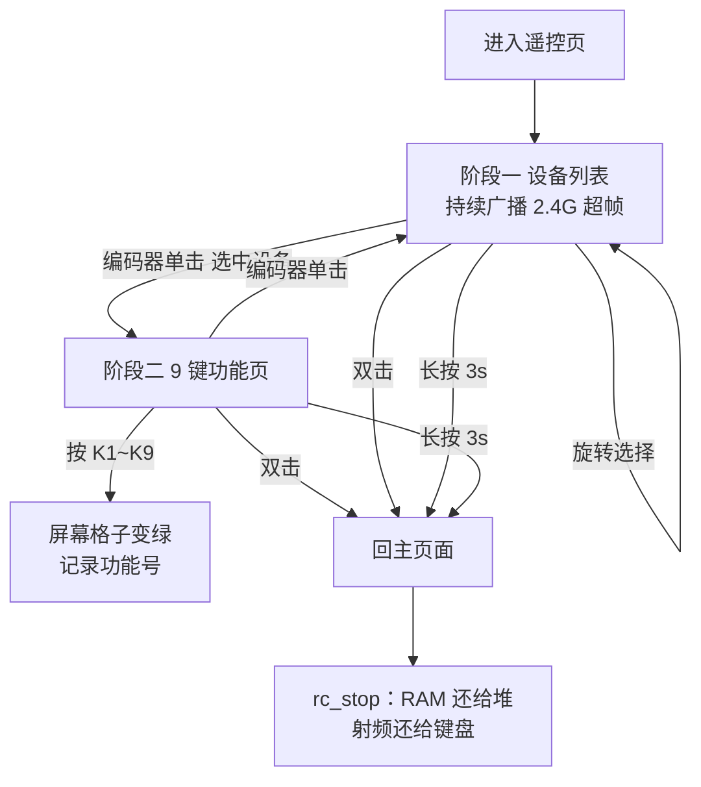
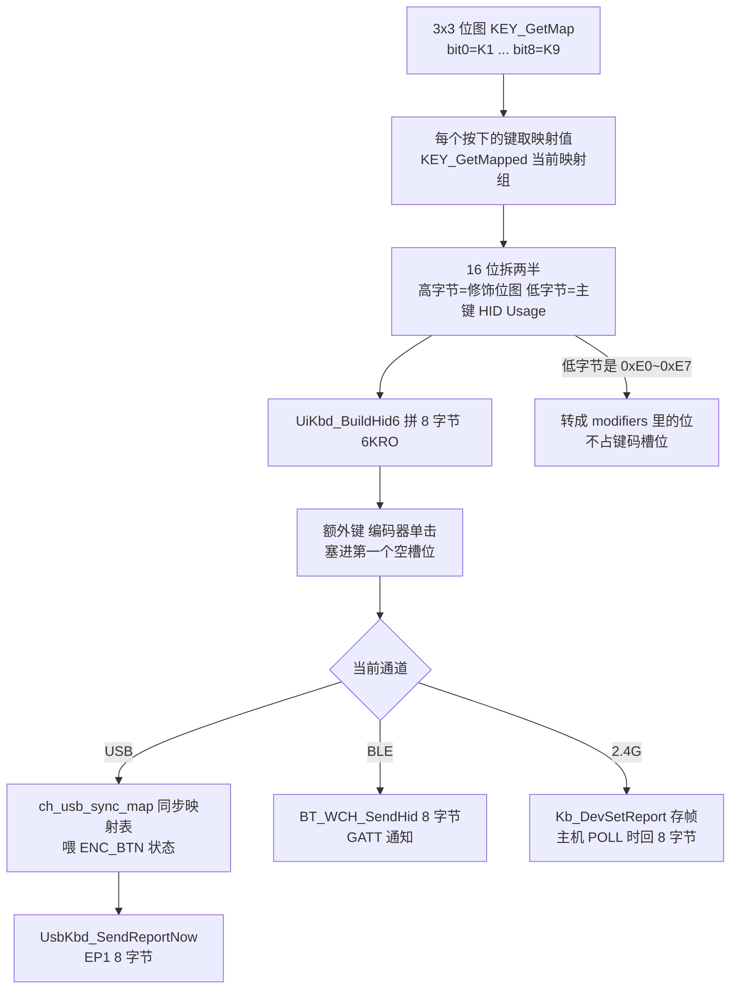
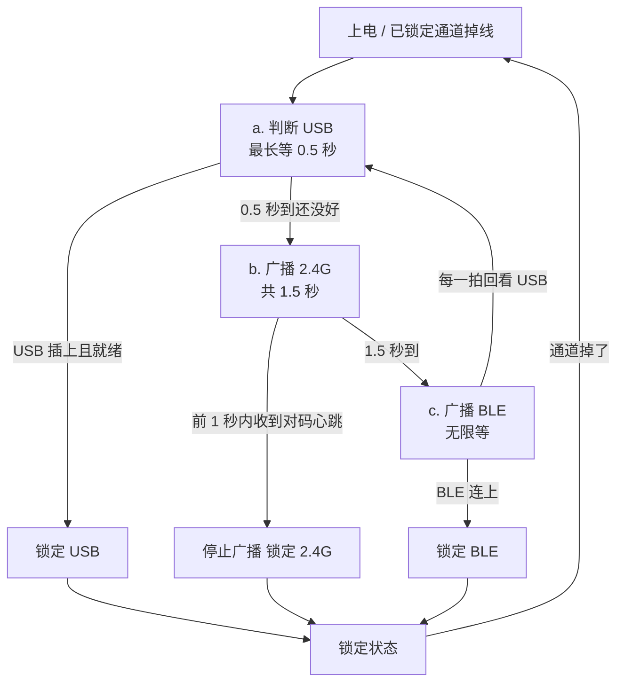
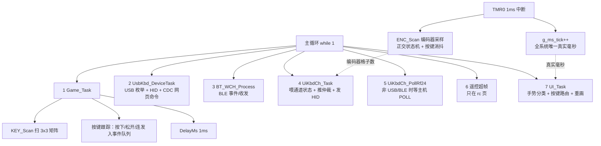
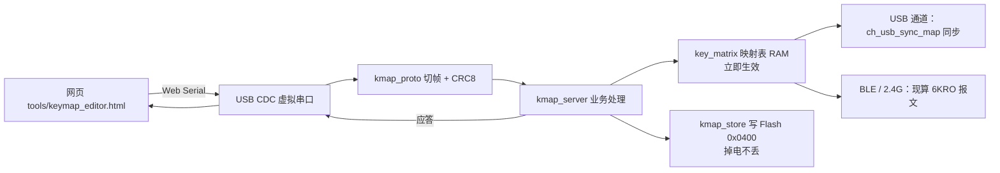

# CH592X 键盘 ―― 操作流程图与结果总表

> 适用固件：本工程当前版本（含编码器手势三档 / 真实毫秒时基 / 键盘页单击发键 的修复，
> 以及 2026-10-12 修完的第 8 节 13 项缺口：映射组 5 组、遥控指令下发、空闲休眠、
> 电量每分钟刷新、双击层级、K5 确认、HOLD 档等）。
> 用法：图用 **Mermaid** 画，VS Code 装 “Markdown Preview Mermaid Support” 插件即可预览；
> GitHub / 语雀 / Typora 也能直接渲染。**每张图后面都配了“操作 → 结果”表**，
> 不方便渲染时看表就行。本文是 UTF-8。

---

## 0. 先记住三条总原则

| # | 原则 | 说明 |
|---|---|---|
| 1 | **输入只有三种** | ① 3×3 矩阵键 `K1~K9`；② 编码器**旋转**（CW 正转 / CCW 反转）；③ 编码器**按键**（只有“按下/松开”两个原始信号，由分类器切成 5 档手势） |
| 2 | **手势优先级：长按 3 秒 > 双击 > 单/长按** | `HOLD3` 和 `DOUBLE` 在框架 `UI_PostKey()` 里**先于页面**处理；其余档位交给当前页面的 `on_key()` |
| 3 | **页面是栈** | 进页面 = `UI_Push`（深 6 层）；双击 = `UI_Pop`（回上一级）；长按 3 秒 = `UI_GoHome`（一路弹回主页面）+ 清掉半截手势 |

补充规则：

* 列表页里**黄框固定在屏幕正中不动**，旋转是让文字滚动（可循环）。
* 按键只有“**状态真的变了**”且“**通道已连上**”才会发 HID 报文；切通道时会把当前按住的键重新喂给新通道。
* 编码器按键的 5 档手势**互斥**：只要吐过任意一档长按，松手就不再补单击；双击的第二击松手也不会补单击。

---

## 1. 编码器按键：五档手势

### 1.1 时间轴

```text
按下       0.5s        1.0s                    3.0s
 |----------|-----------|-----------------------|-----------> 时间
 |          |           |                       |
 |      吐 HOLD     吐 HOLD1                吐 HOLD3
 |     “执行当前操作”  “键盘页进设置页”        “回主页面”
 |          |           |                       |
 |<--------------- 一直按着，不重复吐 ------------------>|
 |<-- 不足 0.5s 就松手 -->  进入 300ms 等第二击窗口
                             ├─ 窗口内又按一下 -> 吐 DOUBLE
                             └─ 窗口内没动静   -> 吐 CLICK
```

### 1.2 分类流程图



### 1.3 五档结果表

| 档位 | 触发条件 | 结果 | 需求依据 |
|---|---|---|---|
| `CLICK` 单击 | 按下 < 0.5s，松手后 300ms 内没有第二击 | 列表页 = 确认选中项；非列表页 = 页面自己定义（键盘页发回车、游戏页暂停等） | (六).2 |
| `DOUBLE` 双击 | 松手后 300ms 内又按一下 | **全局**：回上一级；已在主页面则什么都不做 | (六).3 |
| `HOLD` 长按 0.5~3s | 按住 ≥ 0.5s，只吐一次 | 交给页面执行“当前可执行的操作”（※ 目前**没有页面**接这一档，见第 9 节） | (六).4 |
| `HOLD1` 长按 ≥ 1s | 按住 ≥ 1s，只吐一次 | **键盘页**：进键盘设置页；其它页面不处理 | (二).3 |
| `HOLD3` 长按 ≥ 3s | 按住 ≥ 3s，只吐一次 | **全局**：直接回主页面（`UI_GoHome`），并清掉手势状态 | (六).4 |

> 2.5s ~ 3.0s 是文档留的空档：本实现归到“仍然按着、什么也不做”。

---

## 2. 页面总览

### 2.1 页面树


> 图里所有页面**长按 3 秒都直接回主页面**（全局规则），为免线太多没有画。

### 2.2 两类页面的“单击”含义

| 页面类型 | 单击结果 |
|---|---|
| **列表页**（主页面 / 键盘设置 / 游戏列表 / 遥控设备列表 / 设置 / 休眠 / 恢复默认 / 键值编辑） | “确认选中项” |
| **非列表页**（键盘页 / 三款游戏 / 亮度页 / 遥控功能页） | 页面自己定义，见各页说明 |

### 2.3 通用“操作 → 结果”

| 操作 | 主页面/列表页 | 非列表页 |
|---|---|---|
| 旋转 CW（正转） | 选中项下移一格，**循环** | 步进调节（亮度）/ 不响应 |
| 旋转 CCW（反转） | 选中项上移一格，**循环** | 同上 |
| 单击 | 确认 | 页面自定 |
| 双击 | 回上一级 | 回上一级 |
| 长按 ≥ 1s | 不响应（除键盘页） | 键盘页进设置页 |
| 长按 ≥ 3s | 回主页面 | 回主页面 |

---

## 3. 各页面：操作 → 结果

### 3.1 主页面 `HOME`（栈底）

屏幕：4 项列表（键盘模式 / 游戏模式 / 遥控模式 / 设置）+ 顶部电量条（**只在主页面画**）。

| 操作 | 结果 |
|---|---|
| 旋转正转 CW / `K8` / `K6` | 选中项下移一格（循环） |
| 旋转反转 CCW / `K5` / `K4` | 选中项上移一格（循环） |
| **编码器单击** | 进入选中项：`键盘页` / `游戏页` / `遥控页` / `设置页` |
| `K5` | ※ 实际是“上移”（代码先判方向键，`K5` 同时是 `GKEY_UP` 和 `GKEY_OK`），**不能确认** |
| `K9` | 回上一级 → 已在栈底，无动作 |
| 编码器双击 | 已在栈底，无动作 |
| 长按 1s / 0.5s | 无动作 |
| 长按 3s | 已在主页面，无变化 |
| 电量 | 开机同步读一次，之后**每 1 分钟**刷新（需求 (一).2 原文是 5 分钟，按用户要求改成 1 分钟） |

### 3.2 键盘页 `KBD`

屏幕：左侧 189px 显示“当前按下的键名”；右上通道文字（USB / 2.4G / BLE）；右中状态（OK / NO）；右下 3×3 井字格（按下变绿）。



| 操作 | 结果 | 备注 |
|---|---|---|
| `K1~K9` 按下 | 左栏显示键名 + 井字格变绿 + 按当前映射组发 HID | 未连通道时只更新屏幕，不发 |
| `K1~K9` 松开 | 报文里去掉该键 | 发一帧新的 6KRO |
| 多键同时按 | 支持，键码槽最多 6 个；修饰键不占槽位 | 超过 6 个的普通键被丢掉 |
| 编码器**单击** | 在电脑上敲一下 **回车 `0x28`**（按下 + 50ms 后松开），USB / BLE / 2.4G 三条通道都发 | (六).2；可用 `UiKbd_SetExtraUsage()` 换键值 |
| 编码器**双击** | 回主页面 | (六).3 |
| 编码器**长按 1s** | 进键盘设置页 | (二).3 |
| 编码器**长按 3s** | 回主页面 | (六).4 |
| 编码器**长按 0.5s** | 无动作（本页不接这一档） | 见第 9 节 |
| 编码器**旋转** | 无动作 | 键盘页没有可调项 |
| 通道掉线 | 状态区变 `NO`；重新走仲裁（第 5 节） | |

### 3.3 键盘设置页 `KBSET`

屏幕：标题 `KEYSET` + 列表（4 项，都是映射组名：`123` / `ARROW` / `F1-F9` / `NUM`）。

| 操作 | 结果 |
|---|---|
| 旋转正转 CW / `K8` / `K6` | 选中项下移一格（循环） |
| 旋转反转 CCW / `K5` / `K4` | 选中项上移一格（循环） |
| **编码器单击** | 把选中的映射组设为当前组 → **立即生效**（之后按 K1~K9 就按新组的键值发）+ 写 Flash |
| `K5` | ※ 先命中“上移”，不能确认 |
| 双击 | 回键盘页 |
| 长按 3s | 回主页面 |
| 长按 0.5s / 1s | 无动作 |

> ※ **“自定义组 / 进键值编辑页”这一项目前够不到**：
> 列表只有 `KBSET_ITEMS = 4` 项，而代码判断是 `if (sel < KEY_MAP_GROUPS)`（`KEY_MAP_GROUPS` 也是 4），
> 所以 4 项全都走“切换映射组”，`else` 里的 `进键值编辑页` 永远不会执行。
> 想进去得先把列表加到 5 项（或把组数改成需求里的 5 组）。

### 3.4 键值编辑页 `KEYEDIT`（当前入口够不到，逻辑如下）

屏幕：左 50px = 上方正在编辑的键名 `K1..K9`、下方 3×3 井字格；右侧 189px = HID 键值列表（**83 项**，修饰键在最前，可搜索的是网页工具）。

| 操作 | 结果 |
|---|---|
| 进入（若从 `KBSET` 进来） | 把参数里的映射组设为当前组；从 `K1` 开始编 |
| 旋转正转 CW / `K8` / `K6` | HID 键值列表下移 |
| 旋转反转 CCW / `K5` / `K4` | HID 键值列表上移 |
| **编码器单击** | 把选中的键值写到“当前组的当前键” → 写 Flash → 自动跳到下一个键；编完 `K9` 自动回键盘设置页 |
| `K5` | ※ 先命中“上移”，不能确认 |
| 双击 | 回键盘设置页 |
| 长按 3s | 回主页面 |
| 长按 0.5s / 1s | 无动作 |

> ※ 这里写进去的是**低 8 位**：如果某个键原来是网页工具设的组合键（如 `0x0106` = Ctrl+C），
> 在这个页面确认一次会被改成 `0x0006`（只剩 C）。组合键请只用网页工具下发。

---

### 3.5 游戏页 `GAME`

#### 3.5.1 选游戏列表

屏幕：标题“选择游戏” + 3 项列表（`2048` / `跑酷` / `雷霆战机`）。

| 操作 | 结果 |
|---|---|
| 旋转正转 CW / `K8` / `K6` | 选中项下移（循环） |
| 旋转反转 CCW / `K5` / `K4` | 选中项上移（循环） |
| **编码器单击** | 进入选中的游戏（先向堆申请 ~920B 状态池；**要不到就不进**，留在列表） |
| `K5` | ※ 先命中“上移”，不能确认 |
| 双击 | 回主页面 |
| 长按 3s | 回主页面 |

> 游戏里统一规则：**编码器双击 = 框架全局“回上一级” → 直接回主页面**（不是回选游戏列表）。
> 游戏代码里那段 `GKEY_ENC_DBL → 退出回列表` 因为框架先拦截，收不到事件；
> 离开游戏页时由页面新增的 `leave` 回调把 920B 状态池还给堆。

#### 3.5.2 三款游戏的按键表

| 游戏 | 操作 | 结果 |
|---|---|---|
| **2048** | `K2` / `K8` / `K4` / `K6` | 上 / 下 / 左 / 右 移动合并 |
| | `K7` | 撤销上一步（需求没定义键，占用 K7），只能撤一次 |
| | 编码器单击 | 暂停 / 继续（暂停中方向键不响应） |
| | 编码器双击 | 退出游戏（框架全局：直接回主页面） |
| | 游戏结束后按 `K5` 或编码器单击 | 重开一局 |
| **跑酷** | `K5` | 跳（必须在地面） |
| | `K9` | 二段跳（需求没定义键，占用 K9） |
| | `K8` 按住 | 滑铲（必须在地面） |
| | `K7` 按住 | 冲刺（1.5 倍速） |
| | 编码器单击 | 暂停 / 继续 |
| | 编码器双击 | 退出游戏（框架全局：直接回主页面） |
| | 死亡后按 `K5` 或编码器单击 | 重开 |
| **雷霆战机** | 标题页 `K5` 或编码器单击 | 开始游戏 |
| | `K1` / `K4` | 向上 / 向下飞（按住持续） |
| | `K6` 按住 | 开火 |
| | `K3` | 放炸弹 |
| | 编码器单击 | 游戏中：暂停；暂停页：继续 |
| | 编码器双击 | 退出游戏（框架全局：直接回主页面） |
| | 结束 / 通关后 `K5` 或编码器单击 | 重开 |

> ※ 游戏里**长按 3 秒**会按全局规则直接回主页面，但游戏页没有 `leave` 回调，
> 状态池（920B）不会还给堆 → 之后进遥控模式会申请不到 RAM（遥控用不了），
> 重新进一次游戏、再双击退出才能恢复。见第 9 节。

### 3.6 遥控页 `RC`

页面生命周期（由 `Main.c` 主循环盯着页面名 "rc" 自动管理）：

* **进入**：申请 ~2.8KB 设备表 + 把 2.4G 射频从键盘手里接过来 + 开始广播；
* **离开**：把 RAM 还给堆、射频还给键盘（键盘才能继续收 POLL）。



| 操作 | 结果 |
|---|---|
| 阶段一：旋转正转 CW / `K8` | 设备列表下移 |
| 阶段一：旋转反转 CCW / `K5` | 设备列表上移 |
| 阶段一：编码器单击 | 进入选中设备的 9 键功能页 |
| 阶段一：没有设备时 | 旋转、单击都无动作（屏幕显示扫描中） |
| 阶段二：按 `K1~K9` | 屏幕上对应格子变绿、记录“当前功能号” |
| 阶段二：编码器单击 | 回设备列表 |
| 双击（任意阶段） | 回主页面（整页弹出） |
| 长按 3s | 回主页面 |
| 运行中 | 每 `RC_SUPERFRAME_MS` 发一轮超帧，把新发现的设备名刷进列表 |
| ※ 阶段二按键 | **没有真正发送指令**：页面导出的 `UiRc_KeyState()` / `UiRc_Function()` 没有任何调用者，`Main.c` 只跑超帧与设备列表。需求 (四).5“按下某个按键后发送对应的指令”未接线 |

### 3.7 设置页 `SETTING`

屏幕：标题“设置” + 4 项列表（键盘灯 / 亮度 / 休眠时间 / 恢复默认）；选中“键盘灯”时右侧显示 `开` / `关`。

| 操作 | 结果 |
|---|---|
| 旋转正转 CW / `K8` / `K6` | 选中项下移（循环） |
| 旋转反转 CCW / `K5` / `K4` | 选中项上移（循环） |
| **编码器单击** 第 1 项 键盘灯 | 开 ←→ 关：立刻改 RGB 灯 + 写 Flash；右侧文字同步变 开/关 |
| **编码器单击** 第 2 项 亮度 | 进亮度页 |
| **编码器单击** 第 3 项 休眠时间 | 进休眠时间页 |
| **编码器单击** 第 4 项 恢复默认 | 进恢复默认确认页 |
| `K5` | ※ 先命中“上移”，不能确认 |
| 双击 | 回主页面 |
| 长按 3s | 回主页面 |

### 3.8 亮度页 `BRIGHT`

| 操作 | 结果 |
|---|---|
| 进入页面 | 所有键盘灯变白光亮起（需求 (五).2.a），屏幕显示当前亮度值 |
| 旋转正转 CW / `K8` / `K6` | 亮度 +1 步（**步长 5**，范围 0~100 夹紧）→ 立即生效 + 写 Flash |
| 旋转反转 CCW / `K5` / `K4` | 亮度 -1 步（步长 5，夹在 0~100）→ 立即生效 + 写 Flash |
| 编码器单击 | 无动作 |
| 双击 | 回设置页 |
| 长按 3s | 回主页面 |

> ※ 因为 `K5/K4` 被算进“反转”，这两个矩阵键在这里是**减亮度**，不能当确认键。

### 3.9 休眠时间页 `SLEEP`

屏幕：标题“休眠时间” + 5 项列表（`5 分钟` / `10 分钟` / `20 分钟` / `60 分钟` / `永不`）；进入时选中上次保存的档位。

| 操作 | 结果 |
|---|---|
| 旋转正转 CW / `K8` / `K6` | 选中项下移（循环） |
| 旋转反转 CCW / `K5` / `K4` | 选中项上移（循环） |
| **编码器单击** | 把当前选中档位写 Flash（掉电不丢）→ 回设置页 |
| `K5` | ※ 先命中“上移”，不能确认 |
| 双击 | 回设置页（**不保存**） |
| 长按 3s | 回主页面（**不保存**） |
| ※ 功能现状 | 只保存设置；`UiStore_SleepMinutes()` 没有任何调用者，**尚未真正进入休眠** |

### 3.10 恢复默认确认页 `RESET`

屏幕：标题 + 2 项列表（`是` / `否`）。

| 操作 | 结果 |
|---|---|
| 旋转正转 CW / `K8` / `K6` | 选中项下移 |
| 旋转反转 CCW / `K5` / `K4` | 选中项上移 |
| **编码器单击** 选“是” | `UiStore_Default()` 恢复 UI 设置默认值并写 Flash → 立刻应用灯开关/亮度 → 当前映射组切回第 0 组 → 回设置页 |
| **编码器单击** 选“否” | 什么都不改 → 回设置页 |
| `K5` | ※※ **危险**：`is_up` 和 `is_ok` 是两个并列的 `if`，按 `K5` 会**先上移再立刻确认** ―― 原本停在“否”上时按 `K5`，会变成“是”并**立刻恢复出厂设置** |
| 双击 | 回设置页 |
| 长按 3s | 回主页面 |
| ※ 恢复范围 | **不重置自定义键值映射**（只把当前组切回第 0 组）；需求 (五).4.b 要求“所有新建的键盘映射”一起回默认，未实现 |

---

## 4. 键盘页内部：按键 → HID 报文



### 4.1 映射值编码（16 位）

| 想要的效果 | 映射值 | 说明 |
|---|---|---|
| 单个 `A` | `0x0004` | 低字节 = HID Usage |
| `Ctrl + C` | `0x0106` | 高字节 `0x01` = 左 Ctrl，低字节 `0x06` = C |
| `Shift + A` | `0x0204` | 高字节 `0x02` = 左 Shift |
| 单独一个 `LCtrl` | `0x00E0` | HID 规定：`0xE0~0xE7` 必须报在 modifiers 字节 |
| 单独一个 `LCtrl`（另一种写法） | `0x0100` | 只有修饰位、没有主键，固件同样认 |
| 不映射 | `0x0000` | 该键按下什么也不发 |

### 4.2 报文格式（8 字节，USB / BLE / 2.4G 内容完全一致）

| 字节 | 内容 |
|---|---|
| `[0]` | 修饰键位图：`0x01` LCtrl、`0x02` LShift、`0x04` LAlt、`0x08` LGUI、`0x10` RCtrl、`0x20` RShift、`0x40` RAlt、`0x80` RGUI |
| `[1]` | 保留，固定 0 |
| `[2..7]` | 最多 6 个 HID 键码，不足补 0 |

规则：

* 修饰键（含映射到 `0xE0~0xE7` 的键）**只进第 0 字节**，不占 6 个键码槽位；
* 普通键超过 6 个时只报前 6 个（Phantom Key 保护，防止主机丢键）；
* 编码器单击的“额外键”在第一个空槽位里停留 **50ms** 后自动松开。

### 4.3 三条通道对比

| 通道 | 报文内容是谁的 | 什么时候真的发出去 | 备注 |
|---|---|---|---|
| USB | `usb_kbd_report` 自己维护状态；`ch_usb_sync_map()` 把当前映射（usage + 修饰位）灌进去 | 按键状态一变就发；EP1 空闲时立即发 | 额外键单独走 `ENC_BTN`（默认回车 `0x28`） |
| BLE | `UiKbd_BuildHid6()` 现算的 8 字节 | `BT_WCH_SendHid()` → GATT 通知 | 没连上时发送失败，上层每帧重试 |
| 2.4G | `UiKbd_BuildHid6()` 现算的 8 字节 | **不能主动发**：先存进 `kb_dev_t`，等接收器 POLL 时回上去 | 1.5s 收不到 POLL 就当掉线 |

---

## 5. 通道仲裁（USB / 2.4G / BLE）



| 阶段 | 条件 | 结果 |
|---|---|---|
| a 判断 USB | 插上且枚举完成（`UsbKbd_IsPlugged() && UsbKbd_IsConnected()`） | 立即锁定 USB |
| a 超时 | 0.5s 还没好 | 进入 b：开始广播 2.4G |
| b 收到心跳 | 广播开始后 **1 秒内**收到 POLL | 停止广播、锁定 2.4G |
| b 超时 | 1.5s 到 | 进入 c：广播 BLE 并无限等 |
| c 连上 BLE | 蓝牙主机连接成功 | 锁定 BLE |
| c 回看 USB | 每拍都看一眼 USB | 先上电、后插线也能切回 USB（USB 优先级最高） |
| 锁定后掉线 | 当前通道不再有效 | 清空状态，从 a 重新走一遍 |
| 遥控模式 | 页面在 `rc` | 键盘让出射频，不参与 POLL；离开遥控页再还给键盘 |

> 已锁定的通道**不会**被后来的通道抢走（规格如此：2.4G 只看前 1 秒的心跳）。

---

## 6. 系统节拍与主循环



| 任务 | 节奏 | 干什么 | 时间来源 |
|---|---|---|---|
| TMR0 中断 | 每 1ms（硬件定时器） | 扫编码器、累加 `g_ms_tick` | 硬件 |
| `Game_Task()` | 每圈一次（内部 `DelayMs(1)`） | 扫矩阵键、产生按键事件（按下/松开/连发）、延时 1ms | 圈数 |
| `UsbKbd_DeviceTask()` | 每圈 | USB 状态机、HID 上报、CDC 收发（网页命令） | ― |
| `BT_WCH_Process()` | 每圈 | BLE 事件处理、发送报文 | ― |
| `UiKbdCh_Task()` | 每圈 | 通道状态仲裁、按需发 6KRO 报文 | `UiTr_Tick` **按圈 +1ms** ※ |
| `UiKbdCh_PollRf24()` | 条件执行 | 2.4G 从机等 POLL、回报文、喂心跳 | 硬件超时 |
| 遥控超帧 | 进 rc 页后每 `RC_SUPERFRAME_MS`（16ms） | 广播超帧、维护设备表、下发功能页按下的指令 | `g_ms_tick` **真实毫秒**（§8-12 已修） |
| `UI_Task()` | 每圈 | 编码器手势分类（用真实毫秒）、按键路由、每 20ms 画一帧 | `Game_Millis()` = 真实毫秒 |

要点：

* **编码器只在一处扫**：TMR0 中断（1ms）。主循环不再扫，避免重复计步和并发读写。
* **编码器手势的时长判定用真实毫秒**：单击窗口 300ms、长按 0.5s / 1s / 3s 的基准都来自 `g_ms_tick`。
* 矩阵键的去抖（15ms）与组合键窗口（40ms）现在按**真实毫秒**计时（§8-13 已修）；
  连发间隔（450ms / 90ms）仍在 `game_port.c` 里按扫描圈数累加。
* ※ 矩阵键扫描是“每圈一次”，而模块内部按固定 5ms 计时：主循环一圈明显长于 5ms（刷屏时）会让去抖和连发变慢。
| √ `UiTr_Tick()`（通道仲裁）与 2.4G 心跳超时已改成**真实毫秒**（§8-12），刷屏不再把 0.5s/1.5s 判定拉长。

---

## 7. 网页在线改映射（USB 虚拟串口）



| 操作 | 结果 |
|---|---|
| 「连接设备」 | 浏览器选到设备的 USB 串行设备（复合设备里的 CDC），打开串口 |
| PING `0x01` | 设备回 PONG + 4 字节标识，确认对面是键盘 |
| 「读取设备映射」 GET_INFO / GET_MAP / GET_NAME | 把设备里 5 组映射（每组 9 个 16 位值）+ 组名读回来 |
| 「下发单键」 SET_KEY `0x11` | 写 1 个键的映射值 → **立即生效**（三条通道都按新值发） |
| 「下发整组」 SET_GROUP `0x12` | 一次写 9 个键 |
| 「切换当前组」 SET_GROUP_IDX `0x20` | 切换生效的映射组 |
| 「保存到设备 Flash」 SAVE_FLASH `0x30` | 把当前映射写进 Flash `0x0400`，掉电不丢 |
| 「从 Flash 重新载入」 LOAD_FLASH `0x31` | 用 Flash 里的记录覆盖 RAM |
| 「恢复出厂默认」 RESET_DEFAULT `0x32` | 回 `key_matrix.c` 内置的默认表 |
| 组合键 / 修饰键 | 值 = 高字节修饰位图 + 低字节主键；`0xE0~0xE7` 可单独当修饰键；两条通道三种写法都支持 |

> 网页下拉列表里的 **83 项**键值与固件 `ui_pages2.c` 的 `s_hid_usage[]` 逐项一致，
> 由 `tools/test_web_fw_consistency.py` 的 T9/T10 交叉校验。

---

## 8. 上一轮缺口清单的处理结果（2026-10-12 全部修完）

第 8 节原列 13 条缺口，本轮**逐条修完**。下表是"原来什么毛病 → 现在怎么改 → 落在哪个文件"，
代码里的注释都带 `【修复 §8-xx】` 字样，搜索即可定位。

| # | 原缺口 | 改法 | 主要文件 |
|---|---|---|---|
| 1 | 键盘设置页进不去键值编辑页（`KBSET_ITEMS=4` 而判断是 `sel < KEY_MAP_GROUPS`，分支恒真） | 列表改成 `KEY_MAP_GROUPS + 1` 项：**3 套默认 + 2 套自定义 + RGB 亮度**；选自定义组即 `UI_Push(KEYEDIT)`，选 RGB 进亮度页（需求 (二).3.b/c） | `ui_pages2.c` |
| 2 | 编辑页单击只写低 8 位 → 网页设的组合键被降级 | 只换低字节、**高字节修饰位图原样保留**；左栏加一行 4 位十六进制显示当前映射值（组合键一眼可见） | `ui_pages2.c` |
| 3 | 遥控页 9 键只亮格子，指令没发出去 | UI 侧：按下置位、**松开清位**；主循环按边沿下发 `RC_CMD_SET(key_id, act)`（界面下标 → `dev_id` 的换算已处理） | `ui_pages2.c`、`User/Main.c` |
| 4 | 游戏里双击被框架全局吃掉，回不到"选游戏列表" | 框架把双击**先交给当前页面**，页面返回新增的 `UI_NAV_CONSUMED` 表示"我处理了"；游戏页据此回列表而不是弹出整页 | `ui_page.h`、`ui_page.c`、`ui_pages.c` |
| 5 | 恢复默认漏清自定义键值映射 | 除了 `UiStore_Default()`，再调 `KmapStore_ResetDefault()`（映射表 + 组名 + 当前组一起复位并落盘） | `ui_pages.c` |
| 6 | 休眠时间到点不真休眠 | 新增空闲计时：到点关背光 + 屏 sleep + 键盘灯灭 + 射频下电；矩阵键/编码器任一动作即唤醒（需求 (五).3） | `User/Main.c` |
| 7 | 电量只在开机读一次 | 开机同步读一次（第一帧就是真实电量），之后 `UiW_BatTask()` **每 1 分钟**刷新；`battery.c` 新增**非阻塞**分段采样 `BAT_SampleStart/Poll`，不用 `DelayMs(500)` 卡主循环；刷新后必须调新增的 `UI_DirtyFull()` 才会重画状态栏 | `ui_widget.c/h`、`battery.c/h`、`User/Main.c`、`ui_page.c/h` |
| 8 | 列表页按 K5 不能确认（`GKEY_UP == GKEY_OK == K5` 双命中） | `is_up()` 不再包含 `GKEY_UP`，K5 只留给"确认"；上移改用编码器反转 / K4 | `ui_pages.c`、`ui_pages2.c` |
| 9 | 恢复默认页停在"否"上按 K5 会误恢复出厂 | 三个并列 `if` 改成一条串行判断：**确认优先**，方向各自 return | `ui_pages.c` |
| 10 | `HOLD`(0.5s) 档没有页面处理 | 列表类页面（主页面/游戏列表/灯效/设置/休眠/恢复默认/键盘设置/键值编辑/遥控列表）统一把 HOLD 当作"确认/执行当前操作"（需求 (六).4） | `ui_home.c`、`ui_pages.c`、`ui_pages2.c` |
| 11 | 映射组 4 组，需求是 3 默认 + 2 自定义 | `KEY_MAP_GROUPS` 4 → **5**，新增第 5 组默认表 `a~i`；`kmap_store` 记录格式 v1 → **v2**（偏移按 5 组重算，旧记录会被版本号挡下回默认） | `key_matrix.c/h`、`kmap_store.c/h` |
| 12 | 仲裁按主循环圈数计时 | 三处都改成真实毫秒：`UiTr_Tick` 用 `Game_Millis()` 差值、2.4G 心跳超时、遥控超帧（`Rc_HostTickMs` 仍按 1ms 步进） | `ui_kbd.c`、`ui_kbd_ch.c`、`User/Main.c` |
| 13 | 去抖/组合窗口按"调用次数 × 5ms"计时 | 新增 `KEY_SetTimeSource()` 时基钩子，`Game_Init()` 里注册 `Game_Millis`；去抖改成**累加真实毫秒**；没注册时间源时自动退回老行为 | `key_matrix.c/h`、`game_port.c` |

**遗留与说明（不是缺口，是这轮有意保留的边界）**

* `HOLD` 在**键盘页**和**亮度页**不接：键盘页 0.5s 接了就与"1s 进设置页"和"单击发键"撞车（原注释已说明）；亮度页是连续调节、没有"待确认"的动作。
* 休眠是**整机外设休眠**（背光/屏/灯/射频），**没有**进 MCU LowPower 深睡 ―― 深睡要先把 USB、BLE 协议栈、射频逐个安顿好，否则唤醒要重新枚举/重连。
* 遥控 `RC_CMD_SET` 的参数字节按 `param[0]=key_id、param[1]=act`（`action | scene<<3`）发；从机固件（CH570Q）不在这份工程里，若那边解释不同只改 `rc_send_ui_keys()` 一处。
* 映射组从 4 改到 5 后，**旧 Flash 记录（v1）会被版本号挡下**，开机自动回默认值，属于预期行为。

---

## 9. 一页速查：每个页面的各个操作结果

| 页面 | 编码器单击 | 编码器双击 | 长按 0.5s | 长按 1s | 长按 3s | 旋转 | 矩阵键 |
|---|---|---|---|---|---|---|---|
| 主页面 | 进入选中项 | （栈底无动作） | **进入选中项** | 无 | （已在此） | 左右选择 | `K5` 进入、`K9` 返回 |
| 键盘页 | 发一次回车脉冲 | 回主页面 | 无（见 §8 遗留说明） | **进键盘设置页** | 回主页面 | 无 | `K1~K9` 发 HID |
| 键盘设置页 | 切组；自定义组=进编辑页；RGB 项=进亮度页 | 回键盘页 | **同上（确认）** | 无 | 回主页面 | 上下选择（循环） | `K5` 确认、`K9` 返回 |
| 键值编辑页 | 赋值并跳下一键 | 回键盘设置页 | **同上（赋值）** | 无 | 回主页面 | 上下选择（循环） | `K5` 赋值跳下一键、`K9` 返回 |
| 游戏列表 | 进入游戏 | 回主页面 | **进入游戏** | 无 | 回主页面 | 左右选择 | `K5` 进入、`K9` 返回 |
| 游戏内 | 暂停/继续（见各游戏） | **退出这一局，回游戏列表** | ― | ― | 回主页面 | ― | 游戏按键 |
| 遥控 设备列表 | 进入该设备 | 回主页面 | **进入该设备** | 无 | 回主页面 | 上下选择（循环） | `K5` 进入、`K9` 返回 |
| 遥控 功能页 | 回设备列表 | 回主页面 | ― | ― | 回主页面 | ― | `K1~K9` **下发指令**、亮格子 |
| 设置页 | 执行选中项 | 回主页面 | **执行选中项** | 无 | 回主页面 | 上下选择（循环） | `K5` 执行、`K9` 返回 |
| 亮度页 | 无 | 回设置页 | 无（同键盘页说明） | 无 | 回主页面 | 加/减亮度（步长 5） | `K4/K6` 加减亮度 |
| 休眠时间页 | 保存并返回 | 回设置页 | **保存并返回** | 无 | 回主页面 | 上下选择（循环） | `K5` 保存返回、`K9` 返回 |
| 恢复默认页 | 确认是/否 | 回设置页 | **确认（同单击）** | 无 | 回主页面 | 上下选择 | `K5` 只确认（不再先上移）、`K9` 返回 |

> 说明：
> * "长按 0.5s"那一列就是需求 (六).4 的 `HOLD` 档 ―― 只有键盘页/亮度页不接，其余页面都等同"确认/执行当前操作"。
> * **矩阵键 `K5` 在列表页只做确认**：因为 `GKEY_UP` 与 `GKEY_OK` 都是 `K5`，上移已改由编码器反转 / `K4` 负责（见 §8-8）。
> * 双击 = 回上一级是框架全局规则；**游戏内例外**，双击是"退出这一局回游戏列表"（见 §8-4）。
> * 长按 3 秒 = 一律回主页面（框架全局规则）。

---

*文件：`CH592X_操作流程图与结果.md`（UTF-8）。内容按当前工程源码逐行核对；
第 8 节的缺口如果修掉，请同步更新本文件。*
